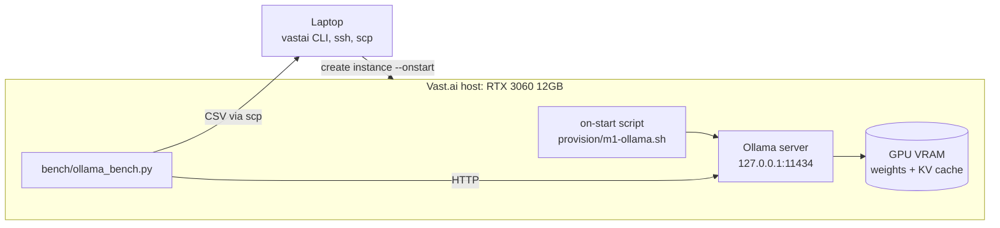

# Milestone 1: a 7B model on a rented $0.07/hr GPU, measured

Run an open model on a disposable cloud GPU, predict its VRAM and speed from first principles, then measure both and explain the gap.

## What it does

- `provision/m1-ollama.sh` turns a bare `ubuntu:24.04` container on Vast.ai into an Ollama server with a model pulled. It is idempotent, so a restart or a second run does no harm, and it fails loudly with a log pointer if the server never answers.
- `bench/ollama_bench.py` measures each model's cold load time and VRAM, then generation speed, prompt speed, time to first token and CPU throttling for each thread setting. It writes a CSV that records the GPU, Ollama version and CPU quota. It uses only the Python standard library.
- The instance is destroyed after every session. Nothing important lives on the rented disk.

## Architecture



Ollama listens on localhost only and has no authentication. It is reached over SSH, never through an open port.

## How to run it

```bash
vastai search offers 'gpu_name=RTX_3060 num_gpus=1 verified=true rentable=true
  gpu_mem_bw>=300 reliability>0.98 inet_down>=500 inet_down_cost<=0.005
  disk_space>=30 cpu_cores_effective>=6' -o 'dph_total'
vastai create instance <OFFER_ID> --image ubuntu:24.04 --disk 30 --ssh --direct \
  --onstart provision/m1-ollama.sh
scp -P <PORT> -i ~/.ssh/vast_ed25519 bench/ollama_bench.py root@<IP>:/root/
# on the box, after "[provision] done" in /var/log/provision.log:
ollama pull qwen2.5:7b-instruct-q8_0
python3 /root/ollama_bench.py --models qwen2.5:7b-instruct-q4_K_M,qwen2.5:7b-instruct-q8_0 \
  --threads default,4,8 --runs 3 --out-dir /root/results
# back on the laptop:
scp -P <PORT> -i ~/.ssh/vast_ed25519 'root@<IP>:/root/results/*.csv' bench/results/
vastai destroy instance <INSTANCE_ID>
```

## Predicted vs measured

RTX 3060 12GB (317 GB/s memory bandwidth), Qwen2.5-7B-Instruct, Ollama 0.40.16, 4,096-token context. Raw runs: [`bench/results/20261119-2230-NVIDIA-GeForce-RTX-3060.csv`](../../bench/results/20261119-2230-NVIDIA-GeForce-RTX-3060.csv).

| | Prediction (made before running) | Measured (2026-11-19) |
| --- | --- | --- |
| VRAM, Q4_K_M | 5.4 GB: 4.7 weights + 0.22 KV cache + ~0.5 overhead | 4,673 MiB (weights 4,168 + KV 224 + compute 143 MiB) |
| Generation, Q4_K_M | ceiling 67.5 tok/s (bandwidth ÷ file size) | 63.8 tok/s |
| Generation, Q8_0 | ~37 tok/s | 41.9 tok/s |
| Prompt processing, Q4_K_M | much faster than generation (compute-bound) | ~2,000 tok/s |
| Cold load from disk to VRAM | | 15–22 s |

The KV cache was predicted from the model config: 2 (K and V) × 28 layers × 4 KV heads × 128 head size × 2 bytes = 56 KiB per token, so 224 MiB at 4,096 tokens. It matched exactly.

## What explained the gaps

**Bytes read per token, not file size.** Q8 beat its file-size ceiling of 39 tok/s. About 0.6 GB of the file is the token-embedding table, which is a lookup (one row per token) and stays off the GPU. What is read per token is what sits in VRAM, about 7.5 GB, which gives a ceiling of 42.2 tok/s. Q8 reached 99% of that and Q4 about 88%, because unpacking 4-bit weights costs more compute.

**The GPU was waiting on the CPU.** On the first host, the same model ran at 39.8 tok/s instead of about 65. The container could see 72 CPUs but had a quota of 8.64. Ollama started 36 threads, which used up the quota in a fraction of each scheduling window, and the kernel froze the container for the rest of it: 54 seconds of throttling during one 128-token request. With 4 threads it ran at 65.1 tok/s with no throttling. On the second host (quota 19.2 CPUs) the thread count made no difference, so a fixed low thread count is free insurance.

| First host (quota 8.64 CPUs) | Prompt tok/s | Generation tok/s |
| --- | --- | --- |
| Default threads (36) | 582 | 39.8 |
| 4 threads | 344 | 65.1 |

## Cost

Two sessions on an RTX 3060 at $0.064–0.068/hr, including all downloads: **$0.15 in total**.

## Demo idea

A 30-second screen recording: the prediction table on the left; on the right the benchmark running, with `nvidia-smi` filling to 4.6 GB, ending on the summary table. Caption: "Predicted 67 tok/s from the spec sheet. Measured 64."
